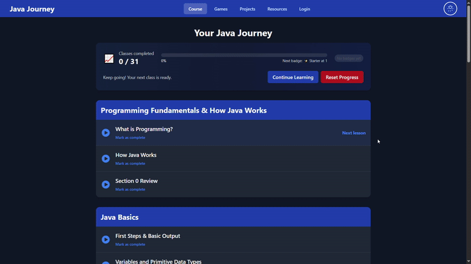
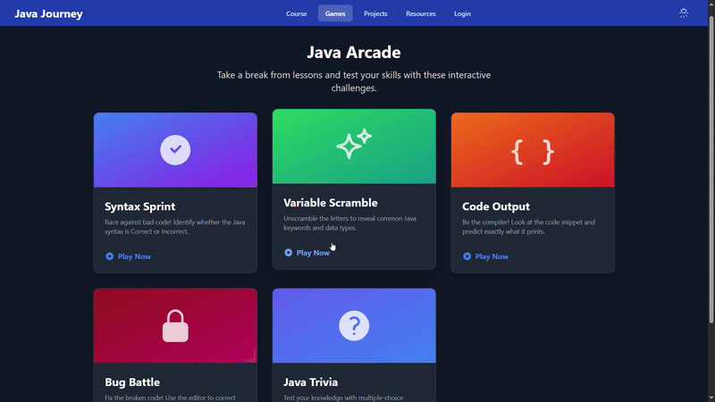
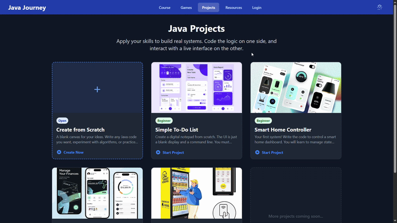

# Java Journey

An interactive Java learning app with lessons, coding exercises, small games, and project workspaces. Built with React, TypeScript, and Vite, with Supabase authentication and saved progress.

[Live app](https://javaforge.vercel.app/)

## What is included

- Guided lessons with concepts, examples, practice, and exercises.
- Games covering syntax, output prediction, debugging, and trivia.
- Project workspaces for a bank, vending machine, smart home, and to-do list.
- Learning resources, progress tracking, and light/dark themes.
- Optional Gemini assistance for explanations and simulated code output.

**Code output is generated by an AI model, not a Java runtime.** Use a local JDK to verify compilation and execution.

## Local setup

Use Node.js 20.19+ or 22.12+ and npm.

```sh
git clone https://github.com/anassdakdaki/Java-Journey-Learning.git
cd Java-Journey-Learning
npm ci
```

Copy `.env.example` to `.env.local` and set the public URL and browser key for your Supabase project. The app requires these values to initialize.

Run [supabase/progress_table.sql](supabase/progress_table.sql) in your project's SQL editor to create the progress table and its access policies. This checked-in schema matches the lesson and step fields used by the app.

```sh
npm run dev
```

Open http://localhost:3001.

## AI configuration

AI features are optional. The current implementation calls Gemini from the browser and reads a user-provided key from local storage or `AI_API_KEY` at build time.

A build-time `AI_API_KEY` is included in the browser bundle. Do not put a shared private key into a public deployment; use a server-side integration before offering shared AI access. Without a key, AI features report that they are not configured.

## Checks

```sh
npm run typecheck
npm run lint
npm run build
npm run preview
```

## Project layout

| Path | Contents |
| --- | --- |
| `App.tsx` | Application state and view navigation |
| `components/` | Lessons, games, projects, and account screens |
| `constants/` | Game, project, and resource content |
| `services/` | AI and public API helpers |
| `src/services/` | Saved progress |
| `supabase/` | Database setup SQL |

## Preview



<details>
<summary>Games and project workspaces</summary>





</details>
